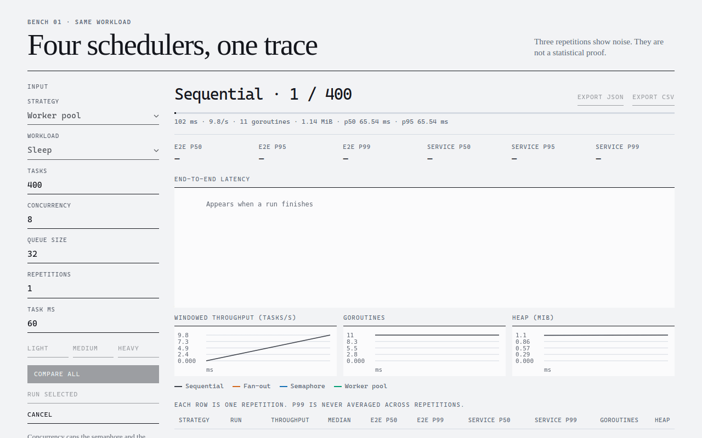

# Go Concurrency Lab

[](https://github.com/Lazzar19/go-concurrency-lab/actions/workflows/ci.yml)


[](LICENSE)

Interactive dashboard for comparing Go concurrency strategies under CPU-bound and sleep-based workloads.



<sub>Recorded from the dashboard while comparing the four scheduling strategies.</sub>

The project is a learning lab. It compares sequential execution, unbounded fan-out, semaphore-limited fan-out, and a fixed worker pool, and it reports throughput, latency percentiles, goroutine usage, and heap usage. The measurements are controlled experiments, not a formal benchmark suite.

## What it demonstrates

| Strategy | Description | Main trade-off |
| --- | --- | --- |
| `sequential` | One task at a time | Simplest baseline, no concurrency |
| `fanout` | One goroutine per task | Maximum fan-out, more goroutine overhead |
| `semaphore` | Fan-out with a concurrency limit | Bounded active work |
| `worker_pool` | Fixed workers consuming a queue | Predictable worker count and queueing |

`queue_size` applies only to `worker_pool`. `0` is an unbuffered queue: the producer waits until a worker takes the task. A larger queue lets tasks wait, and that wait is part of end-to-end latency, not service time. The other strategies ignore `queue_size`.

Two workloads:

- `cpu` hashes a fixed buffer. `iterations` and `bytes` set the amount of work. Duration is an output, so the numbers follow the CPU and `GOMAXPROCS`. This is synthetic scheduling work, not a stand-in for a production service.
- `sleep` waits `task_ms` and releases the processor. It is the better view of work that is not CPU-bound. More concurrency can raise throughput while tasks are waiting.

Do not read a CPU result and a sleep result as the same kind of comparison.

## Quick start

Requires Go 1.27.

```bash
go run ./cmd/server
```

Open [http://127.0.0.1:8080](http://127.0.0.1:8080). With no `HOST`, the process listens on `127.0.0.1`. `PORT` changes the port. `HOST=0.0.0.0` listens on every interface.

```bash
PORT=9090 go run ./cmd/server
```

```bash
HOST=0.0.0.0 PORT=9090 go run ./cmd/server
```

Windows PowerShell:

```powershell
$env:HOST = "127.0.0.1"
$env:PORT = "9090"
go run ./cmd/server
```

CPU results follow `GOMAXPROCS`. The default is the number of logical CPUs Go can see.

`SIGINT` or `SIGTERM` cancels the active run and shuts the server down. Both the HTTP server and the run have about 10 seconds to finish.

## Run with Docker

```bash
docker compose up --build
```

The page is at [http://127.0.0.1:8080](http://127.0.0.1:8080). Compose publishes that address on localhost only. Inside the container, `HOST=0.0.0.0`, so the published port can reach the process. The image runs as a non-root user. `/health` returns `ok` once the process is listening.

A Docker CPU limit or throttle changes CPU numbers. Keep `GOMAXPROCS` the same when you compare two machines or two container limits:

```bash
GOMAXPROCS=2 docker compose up --build
```

Windows PowerShell:

```powershell
$env:GOMAXPROCS = "2"
docker compose up --build
```

An empty `GOMAXPROCS` leaves Go's default, which is the CPU count visible inside the container.

## How to read the results

- **Throughput** is finished tasks per second.
- **End-to-end latency** is the time from submitting a task until it finishes.
- **Service latency** is the time spent in the workload itself.
- **P50** is the middle of that run, the more typical result.
- **P95 and P99** are the slow tail. A high tail can mean queueing or uneven scheduling even when throughput looks fine.
- **Goroutines peak** is the highest goroutine count during the run.
- **Heap peak** is the highest reported heap.

```text
End-to-end latency = queue or wait time + service time
Service latency = time spent executing the workload
```

Percentiles stay on each run. They are not averaged. Throughput across repetitions is summarized with a median. Three repetitions show noise. They are not a statistical proof.

A finished run also reports `go_version`, `gomaxprocs`, and `num_cpu`. Copy those when you compare two runs.

## Limits

| Parameter | Limit |
| --- | ---: |
| `tasks` | 1–100,000 |
| `concurrency` | 0–10,000, or 1–10,000 for `semaphore` and `worker_pool` |
| `runs` | 1–20 |
| `queue_size` | 0–100,000 |
| `iterations` | at most 100,000,000 |
| `bytes` | at most 16 MiB |
| `task_ms` | 1–60,000 ms for `sleep` |
| `tasks * runs` | at most 100,000 |

`queue_size` matters only for `worker_pool`, but a value above the cap is still rejected. `concurrency` is the semaphore size or the worker count. Sequential and fan-out may send `0`. `iterations` and `bytes` size the CPU workload. At least one of them must be positive. `task_ms` sizes the sleep workload. `tasks * runs` bounds the progress monitor and the samples kept for that benchmark.

## Presets

The sidebar presets fill the form. They do not start a run.

| Column | Meaning |
| --- | --- |
| Tasks | Tasks in one run |
| Concurrency | Active tasks, or workers, depending on the strategy |
| Queue | Worker-pool queue size. Other strategies ignore it |
| Runs | Repetitions |
| Iterations | CPU work per task |

| Preset | Tasks | Concurrency | Queue | Runs | Iterations |
| --- | ---: | ---: | ---: | ---: | ---: |
| Light | 200 | 4 | 0 | 1 | 2,000 |
| Medium | 2,000 | 8 | 32 | 3 | 8,000 |
| Heavy | 20,000 | 16 | 128 | 3 | 20,000 |

Presets are starting points for exploration, not canonical benchmark settings. For a meaningful comparison, keep the same preset and the same environment.

## Methodology and limitations

One benchmark runs at a time. The dashboard runs the four strategies one after another, so they do not share the CPU during a single benchmark. CPU results move with `GOMAXPROCS`, with other processes on the machine, and with a Docker CPU limit or throttle.

```text
These measurements are intended for learning and controlled comparison.
They are not a replacement for a formal benchmark suite. Run comparisons
on the same machine with the same Go version, GOMAXPROCS, workload
configuration, and container limits.
```

Hold these still when you compare:

- Go version
- `GOMAXPROCS`
- task count
- iterations
- repetitions
- Docker CPU limit
- operating system or container environment

Results live in memory. A restart drops them, and the process keeps 32 finished jobs. There are no accounts. This is not a public service, and the workload is synthetic.

## HTTP API

```text
GET  /health
POST /api/benchmarks
GET  /api/benchmarks/{id}
POST /api/benchmarks/{id}/cancel
GET  /api/benchmarks/{id}/stream
GET  /api/benchmarks/{id}/export.json
GET  /api/benchmarks/{id}/export.csv
```

| Route | Purpose |
| --- | --- |
| `GET /health` | Returns `ok` when the process is up |
| `POST /api/benchmarks` | Starts one benchmark |
| `GET /api/benchmarks/{id}` | Returns status, summaries, and a downsampled series |
| `POST /api/benchmarks/{id}/cancel` | Stops a running benchmark |
| `GET /api/benchmarks/{id}/stream` | Server-Sent Events, about every 100 ms |
| `GET /api/benchmarks/{id}/export.json` | Downloads every task sample |
| `GET /api/benchmarks/{id}/export.csv` | Downloads one summary row per repetition |

Status codes:

- `202 Accepted` means the benchmark was accepted and started.
- `200 OK` means a status, a result, a cancel, or an export was returned.
- `400 Bad Request` means the JSON, the `Content-Type`, or the configuration is invalid. The body must be a single JSON object with `Content-Type: application/json`. A charset parameter is accepted.
- `404 Not Found` means that benchmark id does not exist.
- `409 Conflict` means another benchmark already holds the process, or an export was requested while a run is still going.

```bash
curl -X POST http://127.0.0.1:8080/api/benchmarks \
  -H "Content-Type: application/json" \
  -d '{
    "strategy": "worker_pool",
    "workload": "sleep",
    "tasks": 100,
    "concurrency": 4,
    "queue_size": 16,
    "task_ms": 10,
    "runs": 3
  }'
```

Closing the progress stream only stops the events. It does not cancel the benchmark. Stop a run with `POST /api/benchmarks/{id}/cancel`. Stopping the process cancels the active run as well.

## Export

After a run finishes, select its row in the dashboard, or call the export routes:

```text
http://127.0.0.1:8080/api/benchmarks/{id}/export.json
http://127.0.0.1:8080/api/benchmarks/{id}/export.csv
```

- JSON contains every task sample: completion time, end-to-end latency, and service time. Use it for a detailed look.
- CSV contains one summary row per repetition. Use it in a spreadsheet or for a statistical pass.
- Export is refused while the benchmark is still running. Completed, cancelled, and failed runs can be exported.

## Project structure

```text
cmd/server/          HTTP server entrypoint and lifecycle
internal/api/        HTTP handlers, SSE, validation and exports
internal/benchmark/  workloads, strategies, metrics and runner
internal/storage/    in-memory benchmark records
web/src/             TypeScript dashboard source
web/build/           Compiled frontend embedded in the binary
```

Change the page in `web/src`, then regenerate `web/build`. The server embeds those compiled files.

## Development and testing

From the repository root:

```bash
go test -race ./...
```

```bash
cd web
npm ci
npm run build
```

Windows PowerShell:

```powershell
Set-Location web
npm ci
npm run build
```

CI runs on every push and pull request. One job runs `go test -race ./...`. The other runs `npm ci`, builds the TypeScript, and fails if `web/build` does not match the source.

## Troubleshooting

### The port is busy

```bash
PORT=9090 go run ./cmd/server
```

```powershell
$env:PORT = "9090"
go run ./cmd/server
```

### Health check

```bash
curl http://127.0.0.1:8080/health
```

The body is:

```text
ok
```

### The Docker service is not healthy

Open [http://127.0.0.1:8080/health](http://127.0.0.1:8080/health). The container must be listening on `0.0.0.0`, which Compose sets with `HOST`.

### The dashboard does not match the source

```bash
cd web
npm ci
npm run build
git diff -- web/build
```

## License

This project is licensed under the MIT License. See [LICENSE](LICENSE).
